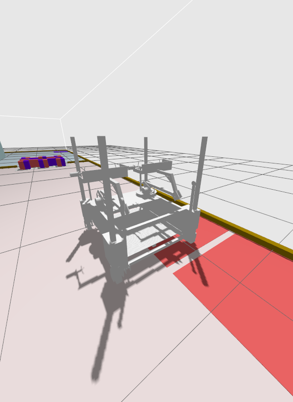

# ares_2027sim

`ares_2027sim` 是面向 ABU Robocon 2027 比赛的 ROS 2 / Gazebo 仿真包，
用于构建比赛场地、物理环境和机器人仿真。ROS 2 发行版应根据操作系统选择；
当前代码已在 Humble / Gazebo Fortress 组合下验证。


## 当前实现

目前的第一版场地包含：

- Ground、L1 和 L2 三级实体平台及对应颜色区域；
- 红蓝双方镜像布置的 3.5 m 实心坡道和 Transfer Area；
- Ground 通往 L1 的四级台阶；
- 每队一个 L1 通往 L2 的实体踏步，尺寸为
  `300 mm × 1000 mm × 150 mm`，L2 灰色平台表面构成第二级；
- L1、L2、坡道、台阶和 Transfer Area 的可见、可碰撞立面；
- 每队一个 `700 mm × 700 mm` 的 L1 BR Retry Zone；
- Ground 与 L1 的红蓝隔离墙、外围挡板及对应碰撞体；
- L1 的 6 个 Building Spot 和 L2 的 4 个 Building Spot；
- Ground Mustika Pillar 与 L2 Central Pillar，包括可碰撞的顶部圆柱形凹槽；
- 红蓝双方各 20 个 `350 mm` Earth Block，按每层 10 个、最多两层放在各自 Storage Area；
- 12 个 `200 mm` Sky Block，按中文版规则图 3 放在 Ground Shared Area 的 5 × 5
  交错点位，中心点留空；
- 每个 Sky Block 由红、蓝两个半立方体组成：四个外表面红蓝各半，两个相对端面分别为
  纯红和纯蓝；初始红蓝分界面朝上，红色半面的方向按图 3 在南北、东西之间交替 90°；
- 放置在 Ground Mustika Pillar 上的动态 Mustika 球，以及运行中的一键复位工具。

Earth Block、Sky Block 和 Mustika 都是带质量、惯量、摩擦与碰撞体的独立动态模型。当前采用
规则给出的质量范围中值：Earth Block 为 `0.275 kg`，Sky Block 为 `0.115 kg`，Mustika 为
`0.420 kg`。这些参数可在取得实物测量结果后继续标定。

## 坐标约定

```text
原点：场地中心
+X：向左，蓝方
-X：向右，红方
+Y：向前
+Z：向上
单位：米
```

## 环境与版本选择

场地生成脚本和原始 URDF 不依赖特定 ROS 2 发行版；ROS 节点使用标准的
`launch_ros`、`robot_state_publisher` 和消息接口。不过，完整仿真还依赖 Gazebo
及其 `ros_gz` 桥接，必须一起选择兼容的版本。

| 操作系统 | ROS 2 发行版 | 默认配套 Gazebo | 本项目当前状态 |
|---|---|---|---|
| Ubuntu 22.04 | Humble | Fortress | 已完成构建、BR 生成及基础关节控制验证 |
| Ubuntu 24.04 | Jazzy | Harmonic | 适合该系统，但当前代码尚需适配 Gazebo 接口并验证 |
| 其他系统 / 发行版 | 按 ROS 2 官方支持平台选择 | 按官方兼容表选择 | 尚未验证 |

参考 [ROS 2 Humble 安装说明](https://docs.ros.org/en/humble/Installation/Ubuntu-Install-Debs.html)、
[ROS 2 Jazzy 安装说明](https://docs.ros.org/en/jazzy/Installation/Ubuntu-Install-Debs.html)
和 [ROS 2 / Gazebo 兼容表](https://gazebosim.org/docs/latest/ros_installation/)。

**当前不能仅替换发行版名称就让完整仿真在所有组合下运行。** 使用 Harmonic 等新版
Gazebo 时，需要检查并适配：

- `launch/ares_2027sim.launch.py` 中的 `ign gazebo` 启动命令、
  `IGN_GAZEBO_RESOURCE_PATH` 和 `ignition.msgs.*` 桥接类型；
- `scripts/prepare_br.py`、`scripts/generate_robocon_2027_world.py` 和生成的世界文件中
  `ignition-gazebo-*` 插件文件名及 `ignition::gazebo::systems::*` 插件名称；
- `test/test_br_model.py` 中的 `ign sdf` 验证命令。

这些属于 Gazebo 版本适配。下面的命令以已验证的 Humble / Fortress 为例；
其他组合应先完成对应适配，再执行构建和运行验证。

## 构建和启动

以下假设仓库位于 `~/ros2_ws/src/ares_2027sim`，请按实际位置调整。先按官方说明安装
适合系统的 ROS 2，然后安装配套组件：

```bash
# 当前代码已验证的组合；其他发行版需先完成上面的 Gazebo 适配
source /opt/ros/humble/setup.bash
sudo apt update
sudo apt install "ros-${ROS_DISTRO}-ros-gz" "ros-${ROS_DISTRO}-robot-state-publisher"
```

Python 环境不要求固定名称。可以使用系统 Python 的虚拟环境，也可以使用已有 Conda
环境；Python 主、次版本必须与安装的 ROS 2 Python 二进制包匹配
（Ubuntu 22.04 / Humble 为 Python 3.10，Ubuntu 24.04 / Jazzy 为 Python 3.12）。
本机验证使用的是 Conda `ares_algo_env`，它不是项目的强制依赖。

下面使用虚拟环境；使用 Conda 时，将创建和激活虚拟环境的两行替换为自己的
`conda activate <环境名>`，并在激活后重新加载对应的 ROS 2 环境。

```bash
cd ~/ros2_ws/src/ares_2027sim
# 已克隆仓库后，拉取 BR 模型子模块
git submodule update --init --recursive

python3 -m venv --system-site-packages .venv
source .venv/bin/activate
# ROS_DISTRO 来自前面 source 的 ROS 2 环境
source "/opt/ros/${ROS_DISTRO}/setup.bash"
python -m pip install -r requirements-dev.txt

colcon build --symlink-install \
  --cmake-args -DPython3_EXECUTABLE="$(command -v python)"
source install/setup.bash
# 显式使用当前 Python 环境执行 ROS 2 CLI
python "$(command -v ros2)" launch ares_2027sim ares_2027sim.launch.py
```

## BR 模型（初步接入）



启动默认生成 `br`，并发布 `/robot_description`、`/joint_states`、`/tf` 和 `/clock`。
默认将 BR 的底盘几何中心放在红方内侧出发区中心 `(-4.35, -5.10)`，
相对原始零朝向向左旋转 90°（yaw = `π/2`）。考虑 CAD 原点与底盘中心的偏移后，
生成时的 CAD 原点位姿为 `(-4.058, -4.8032, 0.16)`；落地后原点高度约 0.129 m。
可以通过 `br_x`、`br_y`、`br_z`、`br_yaw` 调整出生位姿。

```bash
# 无窗口运行；正常启动时省略 headless 参数
python "$(command -v ros2)" launch ares_2027sim ares_2027sim.launch.py headless:=true
# 仅场地，或启动后保持暂停
python "$(command -v ros2)" launch ares_2027sim ares_2027sim.launch.py spawn_br:=false
python "$(command -v ros2)" launch ares_2027sim ares_2027sim.launch.py paused:=true
```

原始模型保存在 Git 子模块 `ares_br_urdf`；新克隆项目后先执行
`git submodule update --init --recursive`。`scripts/prepare_br.py` 在启动时生成仿真
URDF，解析网格路径、使用圆柱车轮与包围盒碰撞体、让车轮连续旋转，并添加 Gazebo 原生
关节控制插件。它不会改写子模块中的 CAD 文件。

| 关节 | 机构 | ROS 命令话题（std_msgs/msg/Float64） |
|---|---|---|
| joint1–4 | 四角升降 | `/br/jointN/cmd_pos`，米 |
| joint5–8 | 四轮转向 | `/br/jointN/cmd_pos`，弧度 |
| joint9–12 | 四轮驱动 | `/br/jointN/cmd_vel`，弧度/秒 |
| joint13–16 | 独立收放的爬楼腿 | `/br/jointN/cmd_pos`，弧度 |
| joint17–30 | 双臂和夹持机构 | `/br/jointN/cmd_pos`，转动用弧度，移动用米 |
| joint31 | 承重支腿 | `/br/joint31/cmd_pos`，弧度 |
| joint32 | 支撑/锁止 joint31 | `/br/joint32/cmd_pos`，弧度 |

例如，展开一条爬楼腿并收回：

```bash
ros2 topic pub --once /br/joint13/cmd_pos std_msgs/msg/Float64 '{data: 0.15}'
ros2 topic pub --once /br/joint13/cmd_pos std_msgs/msg/Float64 '{data: 0.0}'
```

目前所有位置关节使用限速的理想伺服保持零位，四个车轮默认速度为零。命令应处于源
URDF 的关节范围内；轮速命令会持续生效，需要显式发送零速停止。暂未实现车体级
`cmd_vel`、电机力矩标定、真实抓取、传感器及爬楼动作状态机。
`joint31` 和 `joint32` 分别可控，但尚未实现先展开后锁止的联动及物理锁止约束。
碰撞包围盒会填实部分结构空隙，因此当前模型用于初步加载与接口验证，不能用于评估
爬楼或抓取成功率。当前使用 5 ms 物理步长、DART/Bullet 碰撞检测和 PGS 求解器；
本机带界面运行实测约 0.2 倍实时速度，仍需进一步优化。

## 复位 Mustika

仿真运行时，在另一个已加载工作区环境的终端执行：

```bash
cd ~/ros2_ws/src/ares_2027sim
# 激活自己的 Python 环境，例如 source .venv/bin/activate 或 conda activate <环境名>
# 新终端中先加载所选发行版，例如 source /opt/ros/humble/setup.bash
source install/setup.bash
ros2 run ares_2027sim reset_mustika.py
```

该命令通过 Gazebo 的世界服务把 Mustika 恢复到 Ground Mustika Pillar 的初始位置
`(0.000, 4.225, 0.545) m`，可在同一场仿真中重复执行。

## 重新生成场地

提交到项目中的 SDF 世界文件由参数化 Python 脚本生成。修改场地尺寸或颜色后执行：

```bash
cd ~/ros2_ws/src/ares_2027sim
# 使用已激活的 Python 环境
python scripts/generate_robocon_2027_world.py
```

生成结果位于仓库内的 `worlds/robocon_2027.sdf`。

## 测试

```bash
cd ~/ros2_ws/src/ares_2027sim
# 使用已激活的 Python 环境，并加载所选 ROS 2 发行版
python -m pytest test
```

测试覆盖场地尺寸、区域坐标、红蓝镜像关系、台阶尺寸、Retry Zone、Building Spot、
柱体凹槽、主要碰撞结构，以及 Earth/Sky Block 的数量、尺寸、质量与初始摆放。

## Gazebo 可以仿真的比赛内容

### 场地与通行

Gazebo 可以验证机器人在三级场地中的实际通行能力，包括爬坡、上下台阶、越过平台边缘、
通过 Transfer Area 开口以及与挡板和隔离墙发生碰撞。通过配置机器人质量、重心、轮胎摩擦、
电机扭矩和悬挂参数，可以判断底盘是否打滑、托底、倾覆或无法跨越台阶。

### 机器人机构

TR 和 BR 可以分别使用 URDF 或 SDF 建模。仿真可覆盖底盘、轮子、关节、机械臂、升降机构、
夹爪和末端执行器，并向现有 ROS 2 控制、导航和任务程序提供接近真机的关节状态与控制接口。
这适合验证取块姿态、机械臂工作空间、结构干涉以及在 L1、L2 上的操作高度。

### 比赛道具与接触

Earth Block、Sky Block 和 Mustika 可以作为带质量、惯量、摩擦和碰撞体的动态物体。
Gazebo 能模拟抓取、抬升、释放、掉落、堆叠、塔体倒塌、球体滚动以及道具与场地或机器人的碰撞。
夹爪接触仍需要合理的摩擦参数、接触求解设置，必要时还需要抓取约束插件，才能稳定复现真机抓取。

### 传感器与定位

可以加入 RGB 相机、深度相机、激光雷达、IMU、轮速计和关节编码器，并模拟视野、分辨率、
帧率、噪声和延迟。这样可以测试方块识别、Mustika 定位、建塔对准、场地定位、避障和状态估计，
而算法只接收模拟传感器数据，不直接读取 Gazebo 真值。

### 多机器人与对抗

Gazebo 可以同时运行双方 TR、BR，测试会车、路径冲突、共享区域抢占、机器人之间的物理碰撞，
以及通信延迟或消息丢失时的行为。为了重复对比策略，应给每次试验固定初始位姿、道具摆放和随机种子。

### 比赛流程和裁判逻辑

比赛计时、得分、Retry、越区、Transfer Area 交付判定、Building Spot 完整落位、机器人是否仍
接触道具、共享区阻挡计时和 Sanctuary Mandate 等规则不会由 Gazebo 自动理解，需要单独编写
ROS 2 裁判节点。裁判节点可以读取 Gazebo 真值和接触事件，形成可重复运行的整场比赛测试。

推荐的数据边界如下：

```text
Gazebo 真值与接触事件 ──> 裁判节点 ──> 得分、犯规、Retry、比赛状态
模拟传感器数据       ──> 机器人算法 ──> 控制指令 ──> Gazebo
Gazebo 与算法状态     ──> 监控界面
```

### 不应直接当作真机结论的内容

仿真结果会受到摩擦系数、轮胎模型、接触求解器、结构柔性和传感器噪声模型的影响。Gazebo 很适合
验证几何可达性、控制逻辑、任务流程和故障恢复，但抓取成功率、轮胎打滑、结构振动和高速碰撞仍需
通过真机数据标定并进行实物验证。

## 建议的开发顺序

1. 完成场地尺寸、碰撞和颜色校对；
2. 导入 TR、BR 的 URDF/SDF 并接入 `ros2_control`；
3. 加入相机、雷达、IMU 等模拟传感器；
4. 接入导航、机械臂和任务状态机；
5. 实现裁判、计分、Retry 和整场自动回归测试；
6. 使用真机测量数据标定摩擦、质量、惯量、噪声和延迟。
